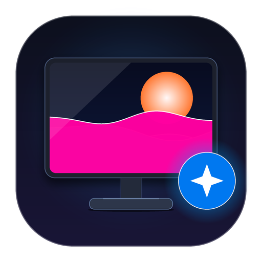
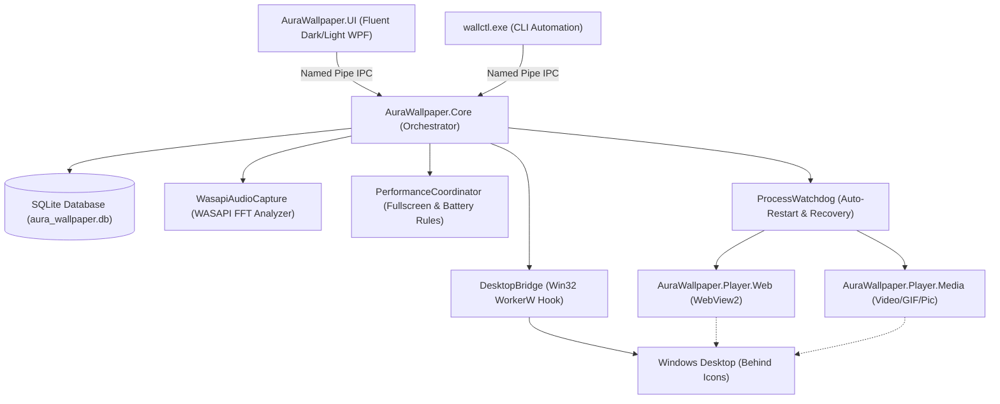

# Aura Live Wallpaper

<div align="center">



# Aura Live Wallpaper
**Next-Generation Live Desktop Wallpaper & Screensaver Platform for Windows**

[]()
[]()
[-0078d4.svg?style=flat-square)]()
[]()
[]()

---

**Developer:** [Rohit Singh](https://github.com/RohitSingh-04) &nbsp;|&nbsp; **Organization:** Rohit Singh Personal &nbsp;|&nbsp; **Built with:** Antigravity (Gemini 3.8 Flash)  
**GitHub:** [@RohitSingh-04](https://github.com/RohitSingh-04) &nbsp;|&nbsp; **LinkedIn:** [linkedin.com/in/rohiyaa](https://www.linkedin.com/in/rohiyaa)

</div>

---

## Overview

**Aura Live Wallpaper** is a production-grade, open-source Windows desktop wallpaper management and hardware-accelerated rendering platform. Engineered with full feature parity with Lively Wallpaper, Aura transforms static monitors into interactive workspaces featuring hardware-decoded video loops, interactive WebGL/HTML5 canvasses, real-time audio visualizers, high-resolution pictures, animated GIFs, Unity games, and screensavers.

Aura utilizes an isolated multi-process architecture to guarantee responsiveness, zero desktop icon interference, and automatic crash recovery without affecting system stability.

---

## Key Features

- **Hardware-Accelerated Video**: Seamless looping for MP4, WebM, MKV, AVI, MOV, and WMV with hardware decoding, volume control, and custom playback speeds.
- **Interactive Web & WebGL**: Render responsive HTML5, Three.js, Canvas, and live web URLs powered by Microsoft Edge WebView2 with sandboxed caching.
- **Real-Time Audio Spectrum Visualizer**: System WASAPI audio loopback capture with a 64-band FFT analyzer streaming real-time frequencies into web wallpapers (`livelyAudioListener` and `auraAudioListener` API compatibility).
- **Desktop Injection Engine**: True Win32 `WorkerW` / `Progman` desktop window injection behind Windows icons with automatic recovery across Explorer restarts (`TaskbarCreated`).
- **Dynamic Property Controls**: Live customizable sliders, color pickers, and dropdowns defined via `LivelyProperties.json`.
- **Multi-Monitor Modes**: Per-Display, Span Across Displays, and Duplicate Modes with automatic display DPI scaling.
- **Performance & Battery Rules**: Automatically pause rendering when fullscreen 3D games or focused applications run, or when on battery power.
- **Taskbar Styling**: Win32 window composition customization (Clear / Transparent, Blur, Acrylic, Opaque).
- **Screensaver Engine**: Native Windows `.scr` integration (`AuraScreensaver.scr`) with full `/s` fullscreen, `/c` settings, and `/p` preview modes.
- **Modern Fluent UI**: Seamless Windows 11 dark and light mode switching, ChatGPT-style sleek auto-hiding scrollbars with Quick Jump Top / Bottom controls, and responsive layouts.
- **Command-Line Automation (`wallctl`)**: Full CLI tool for remote scripting, JSON status telemetry, playlist switching, and volume control.
- **Structured Logging & Diagnostics**: Built-in logging to `%LOCALAPPDATA%\AuraWallpaper\logs\` with a 1-click "Open Logs Folder" shortcut.

---

## Architecture



---

## Lively Wallpaper Feature Parity Matrix

| Feature | Aura Live Wallpaper | Lively Wallpaper | Notes |
|---|:---:|:---:|---|
| **Video Playback** | 100% | 100% | MP4, WebM, MKV, AVI, MOV with GPU acceleration |
| **Interactive WebGL/HTML5** | 100% | 100% | Microsoft Edge WebView2 |
| **Audio Spectrum Visualizer** | 100% | 100% | WASAPI loopback 64-band FFT |
| **`livelyAudioListener` SDK** | 100% | 100% | Full backwards compatibility |
| **LivelyProperties.json** | 100% | 100% | Real-time property modification |
| **Animated GIFs & APNG** | 100% | 100% | High-framerate animated media |
| **Picture Wallpapers** | 100% | 100% | PNG, JPG, WebP, BMP with fit modes |
| **Executable / Unity Embedding**| 100% | 100% | Window reparenting to desktop WorkerW |
| **Native Screensaver (.scr)** | 100% | 100% | Supports preview, configure, and show |
| **Multi-Monitor (Per-Display)** | 100% | 100% | Independent wallpapers per monitor |
| **Multi-Monitor (Span / Dup)** | 100% | 100% | Spans canvas across virtual screens |
| **Taskbar Customization** | 100% | 100% | Clear, Acrylic, Blur, Opaque styles |
| **CLI Automation Utility** | 100% | 100% | `wallctl.exe` with JSON output |
| **Light & Dark Theme Switch** | 100% | Partial | Instant UI toggle with high contrast |
| **Chat-Style Smooth Scrollbar** | 100% | N/A | Arrowless sleek scroll with Top/Bottom jump |
| **Persistent SQLite Storage** | 100% | 100% | Fully normalized schema |

---

## Installation Guide (Windows 10 / 11)

### System Requirements
- **OS**: Windows 10 (version 1809 or higher) or Windows 11 (64-bit)
- **Runtime**: [.NET 8.0 Desktop Runtime](https://dotnet.microsoft.com/download/dotnet/8.0)
- **Web Component**: [Microsoft Edge WebView2 Runtime](https://developer.microsoft.com/en-us/microsoft-edge/webview2/) (Pre-installed on Windows 11)

---

### Option 1: 1-Click Installer (Recommended)

1. Download or extract the release archive (`AuraWallpaper_v1.0.0_Setup.zip`).
2. Right-click **`installer\Setup.bat`** and select **Run as Administrator** (or double-click to install for the current user).
   Alternatively, run PowerShell:
   ```powershell
   powershell.exe -ExecutionPolicy Bypass -File .\installer\Setup.ps1
   ```
3. The setup script will:
   - Deploy binaries and bundled assets to `%LOCALAPPDATA%\Programs\AuraWallpaper\`.
   - Install the desktop shortcut with the modern Aura icon.
   - Install the Windows Start Menu shortcut.
   - Register `wallctl` in your User `PATH` environment variable so it can be called from any terminal.
   - Register the application in Windows **Installed Apps / Add or Remove Programs**.
   - Launch Aura Live Wallpaper automatically.

---

### Option 2: Portable Mode (Zero Installation)

1. Extract `AuraWallpaper_v1.0.0_Portable_x64.zip` to any folder of your choice (e.g., `D:\Tools\AuraWallpaper`).
2. Double-click **`AuraWallpaper.exe`** to run immediately.
3. User data and settings are cleanly isolated in `%LOCALAPPDATA%\AuraWallpaper\`.

---

### Option 3: Building from Source

```powershell
# 1. Clone the repository
git clone https://github.com/RohitSingh-04/AuraWallpaper.git
cd AuraWallpaper

# 2. Build the solution in Release mode
dotnet build AuraWallpaper.sln -c Release

# 3. Run all automated unit and integration tests
dotnet test tests\AuraWallpaper.Tests -c Release

# 4. Generate portable and setup ZIP packages
powershell.exe -ExecutionPolicy Bypass -File .\Package-Release.ps1

# 5. Run the local setup script
powershell.exe -ExecutionPolicy Bypass -File .\installer\Setup.ps1
```

---

## Uninstallation

To cleanly remove Aura Live Wallpaper from your machine:
- Open Windows **Settings > Apps > Installed apps**, locate **Aura Live Wallpaper**, and click **Uninstall**.
- Alternatively, run `installer\Uninstall.bat` or:
  ```powershell
  powershell.exe -ExecutionPolicy Bypass -File .\installer\Uninstall.ps1
  ```
- To also remove local user databases and wallpaper caches, append `-RemoveUserData`:
  ```powershell
  powershell.exe -ExecutionPolicy Bypass -File .\installer\Uninstall.ps1 -RemoveUserData
  ```

---

## Command-Line Automation (`wallctl.exe`)

`wallctl` provides scripting and headless control over the wallpaper engine via low-latency Named Pipe IPC:

```powershell
# Query status and metrics in JSON format
wallctl status --json

# Pause wallpaper rendering (e.g. before launching intense benchmarks)
wallctl pause

# Resume wallpaper playback
wallctl play

# Adjust master wallpaper audio volume (0 - 100)
wallctl volume 50

# Apply a local video or web URL wallpaper to Monitor 0
wallctl set --file "C:\Wallpapers\CyberMatrix.mp4" --monitor 0
wallctl set --url "https://threejs.org/examples/webgl_shaders_ocean.html"

# Pick and apply a random wallpaper from your library
wallctl set --random

# Test native screensaver
wallctl screensaver --show
```

---

## Logs & Diagnostics

All application logs and error diagnostics are structured and stored locally:
- **Log Path**: `%LOCALAPPDATA%\AuraWallpaper\logs\`
- **Files**:
  - `aura_ui.log`: UI lifecycle, display changes, theme switches, and user interactions.
  - `crash.log`: Global unhandled exception traces and crash diagnosis.
- **Easy Access**: Open Aura Wallpaper, navigate to the **Settings** tab, and click **"Open Logs Folder"**.

---

## Taskbar Transparency Notes

Aura Live Wallpaper features built-in Win32 taskbar style management (**Clear / Transparent**, **Blur**, **Acrylic**, and **Opaque**). 

> [!NOTE]
> On newer Windows 11 builds (22621+), Microsoft renders the taskbar background brush within an internal DirectComposition XAML Island (`Windows.UI.Composition.DesktopWindowContentBridge`). Aura applies the standard Win32 `SetWindowCompositionAttribute` flags (`AccentFlags = 2`). If your taskbar has custom Windows accent brushes, ensure **Transparency effects** are enabled under **Windows Settings > Personalization > Colors**.

---

## Developer & Attribution

- **Developer**: **Rohit Singh**
- **Organization**: **Rohit Singh Personal**
- **Built Using**: **Antigravity (Gemini 3.8 Flash)**
- **GitHub**: [@RohitSingh-04](https://github.com/RohitSingh-04)
- **LinkedIn**: [linkedin.com/in/rohiyaa](https://www.linkedin.com/in/rohiyaa)

---

## License

This project is licensed under the **GNU General Public License v3.0 (GPL-3.0)**. See the [LICENSE](LICENSE) file for complete details.
